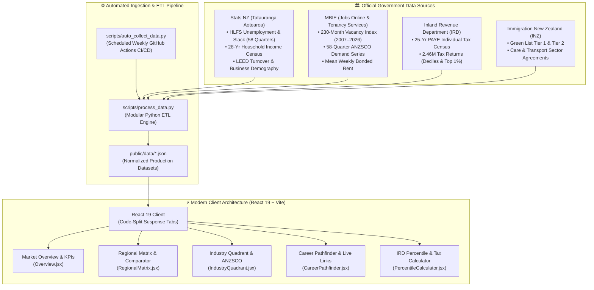
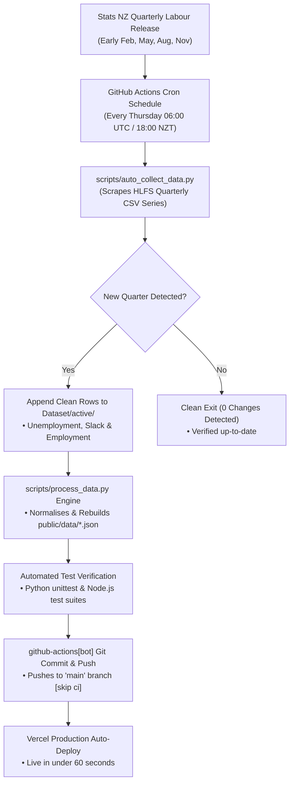

# 🇳🇿 New Zealand Labour Market & Income Intelligence Dashboard

An executive, production-grade analytics platform providing data-driven insights into New Zealand online job vacancies, median/average earnings, mean weekly rents, real purchasing power, labor market slack, and ANZSCO occupational trajectories. Built with **React 19**, **Vite**, **Recharts**, and an automated **Python ETL Data Processing Pipeline** parsing official datasets from **MBIE (Ministry of Business, Innovation and Employment)**, **Stats NZ (Tatauranga Aotearoa)**, and **IRD (Inland Revenue Department)**.

🔗 **Live Production Dashboard**: [https://nz-labour-dashboard.vercel.app/](https://nz-labour-dashboard.vercel.app/)  
📂 **GitHub Repository**: [https://github.com/BinkeXu/New-Zealand-Labour-Market-Income-Intelligence-Dashboard.git](https://github.com/BinkeXu/New-Zealand-Labour-Market-Income-Intelligence-Dashboard.git)

---

## 🏗️ High-Level Technical Architecture

The platform operates on a decoupled, automated architecture connecting official New Zealand government data releases directly to an interactive, high-performance client:



---

## 🌟 Key Features & Interactive Modals

### 🗺️ 1. Interactive 2D New Zealand Regional Choropleth Map & Detail Navigator
- **Lightweight Vector SVG Mapping (`NZRegionalMap.jsx`)**: Built with responsive vector paths (`src/data/nzRegionsPaths.js`) grouped precisely into the 10 MBIE administrative labour market regions. Fully themeable in both Dark Mode (default) and Light Mode.
- **6 Toggleable Map Colour Metrics**:
  - **Vacancies / 100k (Default)**: MBIE online job postings normalised per 100,000 working-age residents (Ages 15–64).
  - **Median Weekly Wage**: Stats NZ gross median weekly earnings before tax.
  - **Purchasing Power**: Net discretionary income after mean weekly rent.
  - **Vacancy Index**: MBIE vacancy index relative to the May 2007 baseline.
  - **Unemployment (%)**: Official Stats NZ Household Labour Force Survey (HLFS) regional unemployment rate (September 2026 Quarter).
  - **Rent / Income (%)**: Housing cost burden ratio (% of gross/net wage spent on mean rent).
- **Interactive Dual-Panel Navigator**:
  - **Default National Summary**: Displays national totals (2.8M working-age population, 10 regions, average wages, and top-performing region) with **Top 3 & Lowest 3 ranked mini-bars** for instant benchmarking.
  - **Selected Region Detail Card**: Clicking any region reveals its wage, rent, vacancy, and unemployment profile, top hiring industries, major cities included, and a **Gross vs. Net (PAYE & ACC)** tax toggle.
  - **1-Click Connected Actions**: Click *"Compare [Region] head-to-head →"* to pre-fill and scroll directly to the `CityComparisonWidget`.
  - **Map-Driven Matrix Filtering**: Clicking a region instantly filters the `CityIndustryTable` below, accompanied by a clickable `"Filtered by: [Region] ×"` reset pill.

### 📊 2. 2×2 Industry Opportunity Scatter Quadrant Chart (`IndustryQuadrantChart.jsx`)
- **Visual Scatter Matrix**: Plots all 10 major industry sectors across **YoY Vacancy Growth (%)** on the X-axis vs. **Median Weekly Wage ($/wk)** on the Y-axis.
- **Strategic Quadrant Tiers**: Visual crosshairs and corner labels guide analysis:
  - **★ Star**: High Growth & High Wage (e.g. Construction, Business Services).
  - **High Salary**: Specialized Niche / Premium Pay.
  - **High Demand**: Accessible Entry / High Hiring Volume.
  - **Stable**: Moderate Replacement Hiring.
- **Dynamic Bubble Scaling**: Recharts Z-axis scales bubble radii dynamically according to each sector's **Opportunity Score**.
- **Connected Career Pathfinder Flow**: Selecting a sector dot opens its strategic recommendation and an actionable button: *"Plan career in [Sector] →"*, which seamlessly navigates to the Career Pathfinder tab with that industry pre-selected.

### 🎛️ 3. Progressive Disclosure & Table De-cluttering
- **Regional Matrix Table Toggle**: Collapsed the 10-region summary table and bar chart behind an accessible **"View full regional table (10)"** accordion toggle, placing the visual Map and Detail Card front and centre.
- **City × Industry Matrix (Top 10 Default)**: Capped dense multi-city industry rows to **Top 10 by default**, with a clear counter (`Showing 10 of 78 rows`) and a **"Show all rows"** toggle.
- **ANZSCO Occupations Table (Top 10 Default)**: Reduced initial page scrolling by defaulting to **Top 10 roles** with a **"Show all 50 rows"** toggle.

### 📑 4. Tabbed National Income Breakdown & IRD Percentile Explorer
- **Streamlined Sub-Navigation (`Overview.jsx`)**: Replaced a long vertical cascade of tables with 4 interactive pill tabs:
  - **By Income Source**: 4 core income streams (Wages, Self-Employment, Government Transfers, Combined).
  - **Ethnicity Demographics**: Stats NZ median hourly and weekly earnings across ethnic groups.
  - **Gender & Pay Tiers**: Gender earnings differentials ($37.50/hr Male vs $31.18/hr Female) and national pay brackets.
  - **Percentile Calculator**: Direct access to the IRD 2.46M taxpayer percentile ranking engine.

### 📊 5. Interactive Historical Trend Modals & Time-Series Analytics
- **KPI Trend Modals**: Clicking any KPI card opens an interactive, centered modal dialog displaying historical trend charts with dynamic time-range filter controls (**`1Y`**, **`3Y`**, **`5Y`**, **`10Y`**, **`All`**) and CSV data export:
  - **NZ Overall Vacancy Index**: 230 monthly series records (May 2007 – June 2026).
  - **NZ National Median Income**: 28-year annual income census series (1998 – 2025).
  - **NZ Official Unemployment Rate**: 59 quarterly HLFS unemployment rates (June 2012 – September 2026, 5.7%).
  - **NZ Labour Underutilisation Rate**: 59 quarterly HLFS underutilisation rates (June 2012 – September 2026, 13.8%).

### 💰 6. National Income Distribution by Source & Breakdown Analytics
- **Category Color Indicators**:
  - 🟣 **Wage & Salary Income** (`#4f46e5`): $1,380/wk ($34.50/hr median) • 2.36M workforce.
  - 🟢 **Self-employment Income** (`#059669`): $921/wk ($23.03/hr median) • 574k business owners.
  - 🟠 **Government Transfer Income** (`#d97706`): $472/wk ($11.80/hr median) • 1.31M recipients (NZ Superannuation, benefits, student allowances).
  - 🔵 **All Sources Combined** (`#0284c7`): $959/wk ($23.98/hr median) • 4.31M population.
- **Interactive Breakdown Modal**: Clicking any row in the Income Distribution table opens a 28-year historical growth chart and a detailed breakdown box comparing median weekly/hourly wages, average weekly/hourly wages, 52-week annualized income, total NZ recipient counts, and policy/tax context notes.

### 🧮 7. IRD Tax Census NZ Income Percentile Calculator & Distribution Histogram
- **26-Year PAYE Tax Dataset**: Integrated 2.84M official Inland Revenue Department (IRD) individual tax returns (2001 – 2026).
- **Interactive Percentile Calculator**: Instant salary ranking calculator ($/yr or $/wk) returning exact NZ percentile position (e.g. *$85,000 puts you in the Top 26% of NZ earners*).
- **Decile & Top Earner Benchmarks**: Displays 10th percentile ($6,880/yr), Median ($61,958/yr), Top 20% ($103,897/yr), Top 10% ($134,568/yr), Top 5% ($169,365/yr), and Top 1% ($289,186/yr).
- **Income Distribution Histogram Chart**: Recharts bar chart displaying worker density across 10 income brackets from <$20k to >$200k+.

### 💼 8. ANZSCO 58-Quarter Demand Trajectory & Authoritative INZ Green List Engine
- **58-Quarter Historical Series**: Extracted 58 historical quarters (2011–2026) for 196 4-digit ANZSCO occupations.
- **Interactive Role Graphs**: Clicking any occupation row (e.g., Software Engineer, Developer Programmer, Registered Nurse, Civil Engineer) opens its historical demand trajectory.
- **Authoritative INZ Residence Pathway Engine**: Replaced heuristic keyword matching with an authoritative 4-digit ANZSCO dictionary (`scripts/config/green_list_anzsco.json`) mapped directly to Immigration New Zealand Operational Manual Appendices 13 and 14:
  - `🟢 INZ Green List Tier 1 (Straight to Residence)` (38 occupations: Developers, Software Engineers, ICT Managers, Civil/Mechanical/Electrical Engineers, Construction Managers, Doctors, Surgeons, Registered Nurses, Secondary & Primary Teachers, Radiographers, Physiotherapists).
  - `🟡 INZ Green List Tier 2 (Work to Residence)` (23 occupations: Electricians, Plumbers, Carpenters & Joiners, Motor Mechanics, Welders, Telecommunication Technicians, Architectural Technicians, Dairy Cattle Farm Managers).
  - `🟣 Sector Agreements (Work to Residence)` (4 occupations: Aged & Disabled Carers, Personal Care Workers, Bus & Coach Drivers, Truck Drivers).
- **Interactive Visa Filter Controls**: Fast-track residence pathway pills allowing users to filter by All (196), Tier 1 (38), Tier 2 (23), Sector Agreements (4), or All Fast-Track Roles (65).

### 🏛️ 9. Head-to-Head Regional Relocation Comparator & Net Take-Home Pay
- **Net Take-Home Pay (After PAYE & ACC)**: Client-side mathematical model of official Inland Revenue Department (IRD) tax brackets (10.5% – 39%) and the 1.60% ACC Earner's Levy (capped at $142,283 income). Provides a toggle between Gross Pre-Tax Wages and True Net Take-Home Pay across all regional purchasing power tables and the percentile calculator.
- **Side-by-Side Relocation Comparator (`CityComparisonWidget.jsx`)**: 2-column comparative tool enabling users to benchmark any two NZ regions head-to-head (e.g. Auckland vs Canterbury) across median income, rent, remaining discretionary cash, vacancy density, regional unemployment rates, rent-to-income ratio, and annual net cash difference.
- **Qualitative Opportunity Score Badges**: Intuitive visual rating bands demystifying Opportunity Scores across all tables:
  - `🟢 High Opportunity (120+)`: Strong vacancy density & premium wage yields.
  - `🟡 Balanced Market (90–119)`: Stable replacement hiring and steady pay.
  - `🔴 Competitive (<90)`: Tighter vacancy availability relative to workforce size.
- **Executive Market Snapshot (TL;DR)**: Top-of-page executive briefing banner on the Overview tab summarizing macro hiring momentum, purchasing power standouts (Canterbury & Waikato), and immigration residence pathways.
- **Actionable Career Links**: Direct 1-click dynamic query links to live vacancy listings on SEEK NZ and TradeMe Jobs within Career Pathfinder.

### 📈 10. Job Volume Estimator & Seniority Level Salary Benchmarks
- **Real-World Annual Openings**: Extrapolates absolute annual job opening estimates across regions, industries, and seniority levels using official Stats NZ LEED turnover rates and Business Demography workforce counts.
- **Seniority-Level Specific Benchmarks**: Dynamic selectors allowing users to filter salary benchmarks and opportunity scores by Junior (0-2 Yrs), Intermediate (3-5 Yrs), Senior (6+ Yrs), and Lead/Executive (10+ Yrs) experience levels.

### 🏠 11. Market Concentration Volume-Weighted Opportunity Score & Regional Matrix
- **Calibrated Opportunity Score Formula**: Combines MBIE Vacancy Indices with regional industry hiring volume shares ($S_{\text{region, industry}}$) and median weekly earnings to prevent index baseline distortions in small regions:
  $$\text{Opportunity Score}_{\text{region, industry}} = \left(\text{Vacancy Index} \times \frac{S_{\text{region, industry}}}{10\%}\right) \times \left(\frac{\text{Effective Weekly Income}}{\$1,200}\right)$$
- **Real Purchasing Power Index**:
  $$\text{Net Discretionary Income} = \text{Median Weekly Wage} - \text{Mean Weekly Rent}$$
- **Granular Table Displays**: Opportunity Scores are computed and displayed for every region, every city/region x industry matrix cell, every industry sector, and every 4-digit ANZSCO occupation.

### ⚡ 12. Modular Enterprise State Architecture & Performance
- **Modularized Python ETL**: Decoupled monolithic processing into dedicated ETL modules (`scripts/etl/income.py`, `vacancies.py`, `workforce.py`, `config.py`).
- **Extensible Chart Strategy Pattern**: Extracted chart configurations into strategy pattern modules (`src/config/chartStrategies.js`) following the Open/Closed Principle.
- **Component Decomposition**: Split heavy pages into smaller focused components (`RegionalLeaderboard.jsx`, `CityIndustryTable.jsx`, `CityComparisonWidget.jsx`, `NZRegionalMap.jsx`, `IndustryQuadrantChart.jsx`).
- **Segregated Memoized Contexts**: Split state into `ThemeContext` (defaulting to Dark Mode), `NavigationContext` (supporting cross-tab deep-linking), and `DataContext` with `useMemo` to eliminate global re-renders.
- **`React.lazy()` & `Suspense` Code-Splitting**: Lazily loads dashboard tabs (`Overview`, `RegionalMatrix`, `IndustryQuadrant`, etc.), dropping initial JS bundle size from **700 kB down to 210 kB** (~70% load speed improvement).
- **React `ErrorBoundary`**: Graceful error catching prevents single-component errors from crashing the entire application.
- **Debounced Inputs**: Search fields use custom `useDebounce` hook to prevent high-frequency re-filtering on keystrokes.
- **RFC-4180 CSV Export**: RFC-compliant CSV escaping for string fields containing quotes, commas, or newlines.

### 🤖 13. Automated Hands-Free Government Data Collection Pipeline

The platform features a resilient, automated CI/CD data ingestion engine that continuously monitors official government publications:



- **Auto-Collector Engine (`scripts/auto_collect_data.py`)**: Directly queries Stats NZ information releases and MBIE release pages, parses embedded quarterly CSV data (HLFS unemployment, underutilisation, employment rates), and automatically appends new quarters to `Dataset/active/` with duplicate-prevention and line-termination safety.
- **One-Command CLI Refresh**: Run `npm run update-data` to scrape, verify, and trigger the ETL rebuilder in a single operation.
- **GitHub Actions Scheduled CI/CD (`.github/workflows/auto-update-data.yml`)**:
  - Automatically runs on a weekly cron schedule (`0 6 * * 4`) following Wednesday morning Stats NZ releases (and on-demand via `workflow_dispatch`).
  - Scrapes for newly published government datasets.
  - Automatically rebuilds production JSONs and verifies compilation.
  - Commits updated datasets back to `main` with `[skip ci]`, triggering immediate live deployment on Vercel with **zero manual developer intervention**.

### 🧪 14. Automated Multi-Tier Test Suite (JavaScript & Python)
- **Unified Test Runner**: Single-command execution (`npm test`) that tests both frontend data transformations and backend ETL pipelines.
- **Node.js Selector, Map & Tax Tests**: High-performance native tests (`src/utils/__tests__/selectors.test.js`, `mapHelpers.test.js`) executed via Node's native test runner (`node --test`).
- **Python ETL & Ingestion Tests**: Comprehensive Python `unittest` suite (`scripts/tests/test_auto_collect.py`, `test_ird_income.py`, `test_green_list.py`, `test_calculators.py`) verifying Stats NZ auto-ingestion, 2026 IRD deciles, mathematical formulas, and INZ visa mappings (25 tests passing).

### 🎨 15. Web Design Engineer & Bento-Grid Refinements
- **Default Dark Mode Aesthetic**: Engineered for high-contrast data visualization, with single-hue sequential scales and glassmorphic elevation.
- **Streamlined Visual Hierarchy**: Absorbed the intermediate release banner into the primary Vacancy Trajectory card header, recovering ~80px of prime vertical viewport space and creating an uninterrupted visual flow from executive KPIs into the primary chart.
- **Unified Atmospheric Canvas**: Replaced conflicting multi-colored background radials with a subtle top-center ambient glow (`radial-gradient(circle at 50% -10%, rgba(99, 102, 241, 0.04) 0%, transparent 55%)`) for maximum contrast and pristine card legibility in both light and dark themes.
- **Typographic Scale & Legibility**: Elevated section titles to `1.4rem` with `-0.03em` tracking and enhanced subtitles with `text-wrap: pretty` and `1.55` line-height for a commanding ~2.4× typographic scale.
- **Touch-Scrolling Navigation**: Responsive `.nav-tabs` equipped with `-webkit-overflow-scrolling: touch` and hidden scrollbars, preventing multi-row layout fragmentation on mobile and tablet devices.

---

## 📁 Dataset Architecture & Provenance

### 📋 Official Government Data Sources & Vintage
| Dataset | Reporting Agency | Cadence | Latest Vintage Tracked | Official Source & Access |
| :--- | :--- | :--- | :--- | :--- |
| **MBIE Jobs Online Index** | MBIE | Monthly & Quarterly | June 2026 (Consolidated) | [mbie.govt.nz](https://www.mbie.govt.nz) |
| **Household Labour Force (HLFS)** | Stats NZ (Tatauranga Aotearoa) | Quarterly | September 2026 Quarter | [stats.govt.nz](https://www.stats.govt.nz) |
| **Household Income Census** | Stats NZ | Annual | 2025 Release | [stats.govt.nz](https://www.stats.govt.nz) |
| **PAYE Individual Tax Deciles** | Inland Revenue (IRD) | Annual | Tax Year ended 31 March 2026 | [ird.govt.nz](https://www.ird.govt.nz) |
| **Tenancy Mean Weekly Rent** | MBIE Tenancy Services | Quarterly | 2026 Release | [tenancy.govt.nz](https://www.tenancy.govt.nz) |
| **INZ Green List & Fast-Track Visas** | Immigration New Zealand | Operational Manual | March 2026 Release | [immigration.govt.nz](https://www.immigration.govt.nz) |
| **Regional Geographic Vectors** | geoBoundaries / LINZ / Stats NZ | Periodic | ADM1 Simplified Release | [geoboundaries.org](https://www.geoboundaries.org) |

### 🗺️ New Zealand Geographic Map Vector Pipeline
The interactive map rendered by `src/components/NZRegionalMap.jsx` is built directly from official geographic boundaries:
- **Source**: geoBoundaries open-license database, mirroring official Land Information New Zealand (LINZ) and Stats NZ administrative divisions.
- **Reproducible Pipeline (`scripts/generate_nz_map_paths.py`)**:
  - Automatically fetches `geoBoundaries-NZL-ADM1_simplified.geojson`.
  - Filters out remote offshore territories (e.g. Chatham Islands 800 km east) to optimize mainland canvas focus.
  - Merges the 16 Regional Councils into the 10 MBIE grouped reporting regions.
  - Projects spherical GPS coordinates into planar SVG pixel coordinates via equirectangular projection centered at 41°S.
  - Compiles the geometries into an ultra-fast ~40 kB ES module (`src/data/nzRegionsPaths.js`).
- **Reproduce anytime via**:
  ```bash
  python scripts/generate_nz_map_paths.py
  ```

### 📂 Raw Datasets in Repository
Active datasets processed by the Python ETL script (`scripts/process_data.py`) reside under `Dataset/active/`:
- `jol-monthly-unadjusted-series-from-may-2007-june-2026.csv` (MBIE Monthly Vacancies)
- `jobs-online-all-unadjusted-quarterly-data-consolidated-march-2026.csv` (MBIE Regional & Industry Vacancies)
- `jobs-online-detailed-occupational-data-march-2026-quarter.csv` (MBIE 58-Quarter ANZSCO Series)
- `Income by sex, region, ethnic groups and income source.csv` (Stats NZ 28-Year Income Census)
- `Census_Population_by_age_by_Regional_Council_2001_2006_2013.csv` (Stats NZ Working-Age Population)
- `mean_weekly_rent.csv` (MBIE / Stats NZ Mean Weekly Rent)
- `Unemployment-rate-by-sex,-seasonally-adjusted,-June-2012–June-2026-quarters.csv` (Stats NZ HLFS Unemployment Rate)
- `underutilisation_rate_by_sex.csv` (Stats NZ HLFS Underutilisation Rate)
- `Wage and salary distributions for individuals.xlsx` (IRD PAYE Individual Tax Returns)

---

## ⚖️ Methodological Limitations & Disclaimers

To maintain complete analytical transparency, users should consider the following data scope limitations:
1. **Online Vacancy Scope**: MBIE Jobs Online measures job advertisements posted on major online job boards (SEEK, TradeMe Jobs). It reflects hiring trends and directional velocity, but does not capture unadvertised vacancies, internal promotions, or informal word-of-mouth hiring.
2. **Lodged Market Rents vs. Sitting Tenants**: Mean weekly rent data is compiled from newly registered tenancy bonds lodged with MBIE Tenancy Services during active quarters. It reflects prevailing market rates for active movers, which typically sit above rents paid by long-term sitting tenants.
3. **Analytical Index Intent**: The Opportunity Score is a proprietary mathematical index developed for comparative career and relocation analysis. It is an analytical indicator, not an official New Zealand government ranking.
4. **Statutory Non-Advice Disclaimer**: Tax calculations, salary benchmarks, and INZ Green List visa summaries are educational models based on statutory rules. They do not constitute certified financial, legal, tax, or registered immigration advice.

---

## 🛠️ Installation, Local Execution & Verification

```bash
# 1. Clone repository
git clone https://github.com/BinkeXu/New-Zealand-Labour-Market-Income-Intelligence-Dashboard.git
cd "NZ Labour Market Intelligence Dashboard"

# 2. Install Node dependencies
npm install

# 3. Run Python ETL Pipeline
python scripts/process_data.py

# 4. Run automated unit tests (JavaScript & Python test suites)
npm test

# 5. Run individual test suites
npm run test:js    # Node.js selector & tax tests
npm run test:py    # Python ETL & Green List tests

# 6. Run automated government data collector (Stats NZ / MBIE auto-ingestion)
npm run update-data

# 7. Build for production verification
npm run build

# 8. Launch local development server
npm run dev
```

---

## 📜 License & Official Data Attribution

- **Application Code**: Licensed under the [MIT License](LICENSE).
- **Official New Zealand Government Data**: Sourced from the **Ministry of Business, Innovation and Employment (MBIE)**, **Stats NZ (Tatauranga Aotearoa)**, and **Inland Revenue Department (IRD / Te Tari Taake)**. Reused under Crown copyright and the **New Zealand Government Open Access and Licensing (NZGOAL)** framework, licensed under [Creative Commons Attribution 4.0 International (CC BY 4.0)](https://creativecommons.org/licenses/by/4.0/).
- **Geographic Boundary Data**: Administrative regional boundaries sourced from **geoBoundaries (Open Data)**, derived from official **Land Information New Zealand (LINZ)** and **Stats NZ** geographic datasets under [Creative Commons Attribution 4.0 International (CC BY 4.0)](https://creativecommons.org/licenses/by/4.0/).
